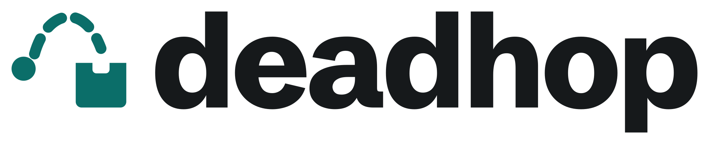
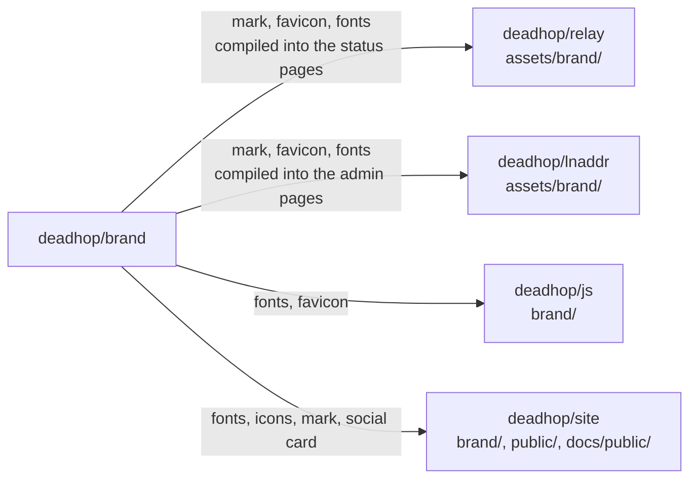

<picture>
  <source media="(prefers-color-scheme: dark)" srcset="logo/lockup-dark.svg">
  
</picture>

**Dials out. Never listens.**

The logo, icons, fonts, colours and design rules of [deadhop](https://deadhop.run), and the
tools that rebuild them.

deadhop is "dead drop" plus "hop". Customer and merchant never meet: payments are left in a
drop, and every message travels relay to relay. "Dead" is also literal, since the service has no
listening socket. The identity combines the two ideas: the **hop** (a dashed arc) and the
**drop** (a box with a slot). It has two faces:

| Face | Used for | Feel |
| --- | --- | --- |
| **Checkout** | pay buttons, invoices, anything a customer sees on a merchant's site | Quiet. Geist sentences, one teal accent, plain words |
| **Developer** | CLI, README, docs, dashboard, npm | Stamped. Martian Mono labels, drop IDs, yellow tags, dark ground |

  
  

Checkout (left) and developer (right), from the dashboard on a test chain.

## Logo

<picture>
  <source media="(prefers-color-scheme: dark)" srcset="logo/mark-fog.svg">
  
</picture>

The mark is a dot (you), a dashed hop, and a slotted drop box. It is one colour,
drawn on a 32-unit grid, and holds at 16 px.

| File | Use |
| --- | --- |
| `logo/lockup.svg` | Default: route-teal mark, graphite wordmark, on light grounds |
| `logo/lockup-dark.svg` | On dark grounds |
| `logo/lockup-mono.svg`, `logo/lockup-mono-fog.svg` | One colour (print, embossing, single-colour contexts) |
| `logo/mark*.svg` | The mark alone; `mark-currentcolor.svg` inherits the text colour |
| `logo/wordmark*.svg` | Wordmark alone |
| `icons/icon.svg`, `icons/icon-*.png` | App, avatar and touch icon (mark on a night tile) |
| `icons/favicon.svg`, `icons/favicon.ico` | Favicons; the SVG switches to fog in dark browser UI |
| `og.png` | 1200 × 630 social card |

The wordmark is Schibsted Grotesk 800, tracked −3.5%, always lowercase, and
converted to outlines so the files need no font.

**Clear space:** at least the height of the box in the mark on every side.
**Minimum size:** mark 16 px; lockup 18 px tall.

Don't:
- Recolour the mark outside the palette, or use bitcoin orange.
- Make the dashes solid. The dashes mean "in transit".
- Put the lockup on busy imagery, add effects, or set the wordmark in another font.
- Add a ₿ glyph, an onion, an ostrich or a padlock to the mark.

## Colour

| Token | Light | Dark | Role |
| --- | --- | --- | --- |
| ground | Concrete `#e9e8e3` | Night `#0e1214` | page background |
| surface | Paper `#f5f4f0` | Depot `#161b1d` | cards, invoices |
| ink | Graphite `#16191b` | Fog `#e6ebe9` | text, mark, primary buttons |
| secondary | Steel `#5b636b` | Haze `#8e979b` | secondary text |
| line | `#cfcdc6` | `#2a3236` | rules and outlines |
| accent | Route `#0b6e69` | Route `#5fc6b9` | the one accent: mark, links, settled progress |
| tag | Tag `#e8c547` | Tag `#e8c547` | small status labels only |

Contrast (WCAG): graphite on concrete 14.4:1, route on paper 5.5:1, steel on paper
5.5:1, fog on night 15.6:1, route on night 9.2:1, haze on depot 5.8:1, graphite on
tag 10.5:1. Every pair passes AA for body text.

All values are custom properties in [`tokens.css`](tokens.css).

## Type

| Role | Face | Where |
| --- | --- | --- |
| Display | Schibsted Grotesk 700–800 | wordmark, headings, amounts |
| Body | Geist 400–600 | sentences |
| Mono | Martian Mono 400–500 | addresses, keys, IDs, code, stamped labels |

All three are SIL Open Font License, self-hosted from `fonts/` (variable, subset
to Latin). Nothing loads from a font CDN, so strict Content-Security-Policies
only need `font-src 'self'`.

## Design language

- **Dashes mean "in transit".** Pending progress, loading and the relay arc are
  dashed. Settled things are solid.
- **Boxes mean "held".** Containers have 4 px corners and 1.5 px outlines, and no
  drop shadows.
- **Yellow is a label, never a fill.** Tag yellow appears only on small stamped
  labels such as `SEEN` or `ports open: 0`.
- **One accent.** Route teal. Everything else is graphite, steel and concrete.
- **Mono for what you copy.** Addresses, IDs, keys and CLI output use Martian Mono.
- **Plain words at checkout, stamps for operators.** Customers read "Payment seen.
  Waiting for 1 confirmation."; operators read `DROP 7F3A · SEEN · 0/1`.
- **A guest on other sites.** The checkout components inherit the merchant's font
  and use a graphite button, so they never compete with the shop's own accent.

## Regenerating

1. `tools/make_fonts.sh` rebuilds `fonts/` from google/fonts (needs `fonttools`, `brotli`).
2. `tools/make_logos.py <SchibstedGrotesk[wght].ttf> brand` rebuilds `logo/` and the SVG
   icons (needs `fonttools`, `uharfbuzz`). The mark's geometry is defined once, at the top
   of this script.
3. `tools/render_rasters.sh` renders the PNG icons, `favicon.ico` and `og.png` (from
   `tools/og.html`) with headless Chrome (needs Pillow).

All three reproduce the committed files byte for byte.

**If anything here changes,** update the copies in the other deadhop repositories. They hold
copies rather than a submodule, so each one builds from its own clone:

- [deadhop/relay](https://github.com/deadhop/relay) and [deadhop/lnaddr](https://github.com/deadhop/lnaddr):
  `assets/brand/` (the mark, favicon and fonts their status pages compile in).
- [deadhop/js](https://github.com/deadhop/js): `brand/` (fonts and icons for the dashboard and console).
- [deadhop/site](https://github.com/deadhop/site): `brand/` (fonts), plus
  `public/{favicon.svg,og.png,apple-touch-icon.png}` and
  `docs/public/{favicon.svg,mark.svg,mark-fog.svg}`. Its `scripts/check.mjs` fails the site build if
  any of them differ from its `brand/` copy.
- The mark is inlined as SVG in deadhop/js `dashboard/src/components/App.svelte` (header) and
  deadhop/site `src/pages/index.astro` (header). Nothing checks these, so update them by hand.

The deadhop maintainers check every copy against this repository.

## License

The logo, icons, colours and tools: [MIT](LICENSE). The fonts in `fonts/` are under the SIL Open
Font License (the `OFL-*.txt` file next to each).
